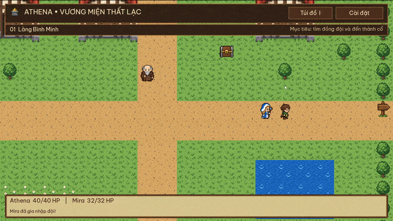
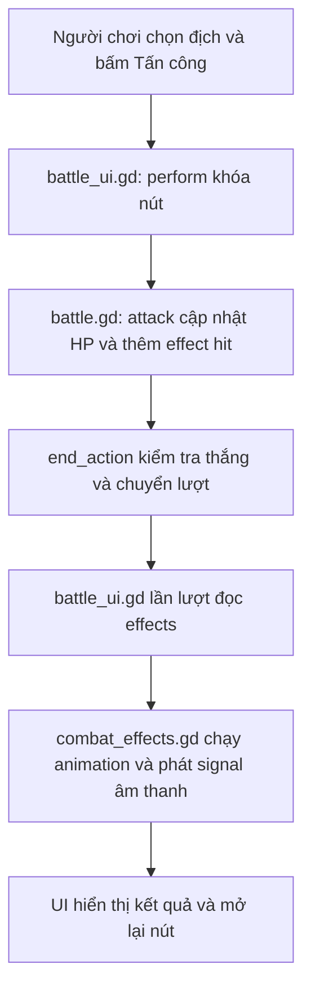

# Athena — Vương miện thất lạc



Một Game RPG 2D nhỏ bằng Godot 4.7.1, dành cho người mới học. 

README này sẽ vừa hướng dẫn chơi, vừa giải thích cách game được xây dựng. Nếu mới học, hãy chơi thử một trận, đọc các phần về dữ liệu nhân vật và luật chiến đấu, rồi làm bài thực hành thêm nội dung ở cuối tài liệu. 

## Tải và chạy dự án

1. Tải toàn bộ mã nguồn dưới dạng ZIP rồi giải nén, hoặc clone kho mã nguồn.
2. Mở **Project Manager** của Godot, chọn **Import** và tìm đến file `project.godot`.
3. Mở dự án và đợi Godot nhập hình ảnh, âm thanh.
4. Nhấn **F5 / Run Project** để chơi thử.


## Cách Chơi

- **WASD / phím mũi tên:** bấm để đi một ô, giữ để đi liên tục. Mỗi bước dài 0,2 giây; thả phím thì hoàn tất ô hiện tại rồi dừng. Không đi chéo.
- **E / Space:** tương tác với đối tượng có popup phía trên (NPC, rương, quái vật).
- **I:** túi đồ. **Esc:** đóng hội thoại, túi đồ hoặc cài đặt.
- **Cài đặt** ở góc trên bên phải: âm lượng, tắt âm, cửa sổ/toàn màn hình, độ phân giải cửa sổ và chơi lại từ đầu.
- Đi tới bất kỳ ô đường trống nào ở mép bản đồ có lối ra để đổi khu vực; không cần chạm đúng biển chỉ đường. Mép có cây hoặc tường vẫn chặn.
- Chạm quái vật để chiến đấu; chọn mục tiêu rồi bấm nút hành động.

Hành trình: **Làng Bình Minh → Đường Rừng Rêu → Thành Tro Tàn**. Nói chuyện với Mira ở làng và Bran trong rừng, bấm **Mời vào đội** ở cuối hội thoại. Đội tối đa 3 người. Trang bị kiếm và giáp ban đầu từ túi đồ, tìm thêm vật phẩm trong rương rồi đánh bại Kỵ sĩ Tro.

Trưởng làng và lửa trại cho nghỉ để hồi HP. Nếu cả đội gục, popup **ĐỘI ĐÃ GỤC** xuất hiện sau hiệu ứng chiến đấu. Bấm **Hồi sinh** để về làng, hồi đầy HP và có ít nhất 2 bình máu. Không tự hồi sinh hoặc tiếp tục di chuyển khi popup đang mở. Những rương đã mở và trận đã thắng vẫn được giữ trong phiên chơi. Chưa có lưu tiến trình chơi ra đĩa; đóng game sẽ bắt đầu lại. Cài đặt âm thanh và màn hình được lưu riêng.

## Bắt đầu đọc project: node, scene, resource và script


| Khái niệm | Hiểu qua project này | Ví dụ |
| --- | --- | --- |
| Node | Một thành phần trong cây scene, có nhiệm vụ cụ thể | `Camera2D` theo nhân vật, `AudioStreamPlayer` phát âm thanh |
| Scene (`.tscn`) | Một cây node đã lưu, có thể dùng lại nhiều lần | `chest.tscn` là mẫu rương; mỗi bản đồ có thể đặt nhiều rương |
| Instance | Một bản sử dụng của scene mẫu | Hai rương có cùng cấu trúc nhưng khác vị trí, vật phẩm và tên node |
| Resource (`.tres`) | Dữ liệu có thể gán cho node hoặc script | `slime.tres` chứa HP/ATK/DEF của slime; không tự đặt slime lên bản đồ |
| Script (`.gd`) | GDScript quy định hành vi và luật | `battle.gd` tính sát thương; `map.gd` kiểm tra ô có đi được không |
| Signal | Thông báo một sự kiện cho thành phần khác | Player phát `move_requested`; Game nhận và kiểm tra bước đi |
| Autoload | Node dùng chung, tồn tại khi thay bản đồ | `Session` giữ đội/túi đồ; `Preferences` giữ cài đặt |

`res://` là đường dẫn tính từ thư mục chứa `project.godot`. Ví dụ `res://data/items/potion.tres` trỏ đến file `data/items/potion.tres` trong project. Biến có `@export` xuất hiện trong Inspector; biến như `hp` chỉ lưu trạng thái khi chơi nên không cần nhập vào file mẫu.

Đọc theo luồng: `scenes/game.tscn` → [game.gd](scripts/game.gd) → [session.gd](scripts/session.gd) → resource trong `data/` → [battle.gd](scripts/battle.gd) → [battle_ui.gd](scripts/ui/battle_ui.gd). Game điều phối, resource cung cấp dữ liệu, UI hiển thị kết quả.

## Nhân vật, đồng đội và NPC

### Dữ liệu nhân vật khác với hình nhân vật trên bản đồ

[PartyMember](scripts/party_member.gd) kế thừa `Resource`. Mỗi file trong `data/party/` mô tả một nhân vật:

| Thuộc tính | Ý nghĩa |
| --- | --- |
| `id` | Mã duy nhất, dùng kiểm tra đã tuyển nhân vật và ghi nhận phòng thủ |
| `display_name` | Tên hiện trên UI |
| `portrait` | Hình trong túi đồ và trận đấu |
| `walk_frames` | Bộ animation đi bộ cho đồng đội theo sau |
| `max_hp` | HP tối đa; HP bằng 0 nghĩa là đã gục |
| `base_attack`, `base_defense` | ATK và DEF trước khi cộng trang bị |
| `hp`, `weapon`, `armor` | Trạng thái khi chơi: HP hiện tại và hai món đang mặc |

Các chỉ số ban đầu, chưa có trang bị:

| Nhân vật | File | HP tối đa | ATK | DEF | Gia nhập |
| --- | --- | --- | --- | --- | --- |
| Athena | [athena.tres](data/party/athena.tres) | 40 | 9 | 2 | Có sẵn khi bắt đầu |
| Mira | [mira.tres](data/party/mira.tres) | 32 | 8 | 2 | Nói chuyện ở làng |
| Bran | [bran.tres](data/party/bran.tres) | 48 | 10 | 3 | Nói chuyện trong rừng |

Hiện tại cả ba dùng chung các hành động đánh, phòng thủ và dùng bình. Chưa có cấp độ, kinh nghiệm, mana hay bộ kỹ năng riêng; hình dáng nhân vật không tạo ra luật chiến đấu khác nhau.

`Session.party` là danh sách nhân vật theo thứ tự gia nhập. `Session.reset()` tạo Athena bằng `HERO.fresh()`. Khi tuyển, `Session.recruit()` kiểm tra mã trùng và giới hạn 3 người, rồi gọi `fresh()` để tạo bản sao với HP đầy, chưa có trang bị. HP thay đổi trên bản sao này, không ghi ngược vào file `.tres` gốc.

Nhân vật ngoài bản đồ là node `World/Player`; hai node `Follower0` và `Follower1` vẽ đồng đội đi theo. Player giữ cách đọc phím trong [player.gd](scripts/world/player.gd), còn bước đi và animation dùng chung [PartyWalker](scripts/world/party_walker.gd). Các thuộc tính hình ảnh của Player nằm trong scene Player; `walk_frames` của resource đồng đội được Game gán cho follower khi di chuyển.

### NPC và hội thoại

Một NPC là instance của `scenes/entities/npc.tscn`, chạy [TownNPC](scripts/world/npc.gd). `dialogue` chứa văn bản; mỗi dòng là một trang. `display_name` là tên người nói, `icon` là hình ngoài bản đồ.

- Gán `companion` bằng resource `PartyMember` để NPC có nút **Mời vào đội** ở trang cuối. Tuyển thành công thì NPC ẩn và người đó theo đội.
- Bật `offers_rest` để có nút **Nghỉ ngơi**, hồi đầy HP cho cả đội, kể cả người đã gục. Với NPC nghỉ ngơi, để `companion` trống vì nhánh tuyển đồng đội được xử lý trước.
- Để cả hai trống/tắt nếu NPC chỉ cung cấp thông tin.

Game chỉ cho di chuyển trong trạng thái `EXPLORE`. Mở hội thoại, túi đồ, trận đấu hoặc popup thua sẽ chuyển trạng thái và khóa điều khiển đi bộ. Riêng Cài đặt còn tạm dừng cả `SceneTree`. Hội thoại không làm tối bản đồ.

## Kẻ địch: mẫu dữ liệu và cuộc chạm trán

[EnemyData](scripts/enemy_data.gd) lưu `display_name`, `portrait`, `max_hp`, `attack`, `defense`. Khi bắt đầu trận, `battle.begin()` gọi `fresh()` cho từng mẫu để tạo HP riêng. Hai slime dùng cùng một resource vẫn có HP độc lập. Vào lại trận sau khi rút lui sẽ tạo địch mới với HP đầy.

| Mẫu địch | File | HP tối đa | ATK | DEF |
| --- | --- | --- | --- | --- |
| Slime cam | [slime.tres](data/enemies/slime.tres) | 18 | 6 | 1 |
| Dơi rừng | [bat.tres](data/enemies/bat.tres) | 16 | 7 | 1 |
| Slime tím | [shade.tres](data/enemies/shade.tres) | 24 | 8 | 2 |
| Lính xương | [skeleton.tres](data/enemies/skeleton.tres) | 28 | 9 | 3 |
| Kỵ sĩ Tro | [warden.tres](data/enemies/warden.tres) | 64 | 12 | 4 |

Để xuất hiện trong thế giới, các mẫu này phải được gán vào một [Encounter](scripts/world/encounter.gd), là instance của `scenes/entities/encounter.tscn` nằm dưới `Entities` của bản đồ. Mỗi Encounter đại diện cho **một trận đấu**, có thể chứa nhiều kẻ địch.

| Thuộc tính Encounter | Cách sử dụng |
| --- | --- |
| `foes` | Mảng 1–3 resource EnemyData; UI chỉ có 3 vị trí địch. Không để phần tử trống |
| `display_name`, `icon` | Tên và hình của cuộc chạm trán ngoài bản đồ, tách biệt với chân dung địch trong trận |
| `reward` | Một resource RPGItem thưởng thêm khi thắng; có thể để trống |
| `boss` | Chặn rút lui; trong Game hiện tại, thắng bất kỳ Encounter nào bật cờ này cũng hoàn thành nhiệm vụ vương miện |

Đi vào ô Encounter hoặc tương tác từ ô bên cạnh sẽ bắt đầu trận. Thắng rồi tiếp tục thì Game ẩn Encounter và lưu khóa dạng `forest/Slimes` trong `Session.cleared`. Rút lui hoặc thua không đánh dấu đã thắng. Tên node và `map_id` vì vậy có ý nghĩa đối với tiến trình, không chỉ là nhãn trong editor.

## Chiến đấu theo lượt: từ nút bấm đến kết quả

Mỗi đồng đội còn sống hành động một lần, sau đó các địch còn sống hành động. Hiệu ứng được phát theo thứ tự; các nút tạm khóa khi đang diễn hoạt để tránh bấm chồng lượt.

- **Tấn công:** sát thương = ATK − DEF, tối thiểu 1.
- **Phòng thủ:** giảm một nửa sát thương nhận trong lượt địch kế tiếp.
- **Bình máu:** chọn đồng đội trong danh sách dưới nút; hồi 24 HP và tốn lượt nếu thành công. Không dùng cho người đã gục hoặc đầy HP.
- **Rút lui:** luôn thành công với trận thường; không thể rút khỏi trận trùm.

Đồng đội gục được bỏ qua lượt; thắng trận thì đứng dậy với 1 HP. Mỗi trận thắng nhận một bình máu, một số trận có thêm trang bị.

### Thứ tự lượt và công thức

`actor_index` chỉ vị trí người đang hành động trong `Session.party`; `round_number` bắt đầu từ 1. Thứ tự vòng đấu là các thành viên còn sống theo thứ tự gia nhập, sau đó các địch còn sống theo thứ tự trong `foes`. Chưa có chỉ số tốc độ hoặc tung xúc xắc chọn lượt.

```text
ATK thực = base_attack + attack_bonus của weapon + attack_bonus của armor
DEF thực = base_defense + defense_bonus của weapon + defense_bonus của armor
Sát thương = max(1, ATK người đánh - DEF người bị đánh)
HP mới = max(0, HP cũ - sát thương)
```

Ví dụ Athena có 9 ATK, trang bị Kiếm sắt cộng 4 thành 13. Đánh Slime cam có DEF 1 gây `13 - 1 = 12` sát thương: slime từ 18 còn 6 HP. Các chỉ số này lấy từ resource và phương thức `attack()`/`defense()`, không tính từ chữ trên UI.

Phòng thủ đánh dấu nhân vật trong `guards` đến hết lượt địch của vòng đó. Sau khi trừ DEF, sát thương được chia đôi và **làm tròn lên**, tối thiểu 1; nhận 7 sát thương sẽ còn 4. Cờ được xóa sau pha địch. Mỗi địch chọn một đồng đội còn sống theo vòng và vị trí của nó: `alive[(round_number + i - 1) % alive.size()]`. Đây là cách chọn cố định, không ngẫu nhiên.

Dùng bình thành công tiêu hao 1 bình và hết lượt của người đang hành động, dù người nhận là đồng đội khác. Đầy HP, đã gục hoặc hết bình thì không trừ vật phẩm và không đổi lượt. Rút lui không có tỉ lệ thất bại ở trận thường; HP và bình đã dùng không được hoàn lại.

### Một lần bấm Tấn công đi qua những đâu?



Nếu người vừa đánh là đồng đội cuối vòng, luật pha địch cũng được tính và thêm vào `effects` trong `end_action()`. UI sau đó phát lần lượt các hiệu ứng đã ghi. Vì vậy luật không phải chờ thời lượng animation mới tính được HP; `busy` khóa thao tác để người chơi không bấm chồng trong lúc xem kết quả.

Trận kết thúc bằng một trong ba giá trị `result`:

| Kết quả | Xử lý trong Game |
| --- | --- |
| `victory` | Sau khi bấm tiếp tục, nhận 1 bình cơ bản và 1 vật phẩm `reward` nếu có, đánh dấu Encounter đã thắng; đồng đội gục đã được nâng lên 1 HP |
| `fled` | Sau khi tiếp tục, trở lại khám phá; Encounter vẫn ở đó |
| `defeat` | Sau hiệu ứng, hiện popup thua; bấm Hồi sinh mới hồi đầy đội, bổ sung đủ ít nhất 2 bình cơ bản và về làng |

**Bài tập đọc code:** mở `battle.gd`, tìm `attack()`, `end_action()` và `enemy_turn()`. Tính trước sát thương khi Athena mặc thêm Áo giáp da rồi nhận đòn từ Slime cam; kiểm tra lại trong game. Với DEF `2 + 3 = 5`, đòn ATK 6 gây 1 sát thương.

## Vật phẩm và kế thừa

`RPGItem` là lớp cha. `Consumable` và `Equipment` kế thừa lớp này:

- `Consumable.use()` hồi máu. Túi đồ chỉ trừ số lượng khi dùng được.
- `Equipment` có slot `weapon` hoặc `armor`, cộng ATK/DEF khi trang bị.
- Trang bị mới sẽ trả món cũ về túi. Nút **Cất vũ khí / Cất giáp** tháo đồ.
- Mỗi nhân vật có trang bị riêng. Không thể chuyển trang bị giữa trận.

File `.tres` trong `data/items/` là ví dụ: bình máu, kiếm sắt, áo giáp da, trượng pha lê. Nhân đôi một file để tạo vật phẩm mới, đặt `id` duy nhất rồi gán vào rương hoặc phần thưởng. `Inventory` lưu số lượng; `PartyMember` tính chỉ số từ dữ liệu gốc cộng trang bị, nên không cộng chỉ số nhiều lần khi thay đồ.

`RPGItem` có bốn trường chung: `id`, `item_name`, `description`, `icon`. `Consumable` thêm `healing`; `Equipment` thêm `slot`, `attack_bonus`, `defense_bonus`. Đây là ví dụ kế thừa: lớp con dùng các trường chung của lớp cha và bổ sung dữ liệu riêng. Chỉ tạo resource RPGItem cơ bản chưa đủ để có hành động dùng hoặc trang bị; hai nhánh UI hiện tại kiểm tra `item is Consumable` và `item is Equipment`.

Túi đồ [Inventory](scripts/inventory.gd) được giữ tại `Session.bag`, dùng hai Dictionary: `items[id]` giữ resource và `counts[id]` giữ số lượng **chưa trang bị**. Ví dụ túi có một kiếm, trang bị cho Athena thì số kiếm trong túi về 0 nhưng `Athena.weapon` giữ món đó; tháo kiếm trả về túi thành 1. Dùng trùng `id` cho hai vật phẩm khác nhau sẽ khiến chúng dùng chung khóa số lượng và ghi đè mẫu trong `items`.

Khi mới chơi, đội có 4 bình hồi máu, 1 kiếm và 1 áo giáp trong túi, chưa tự mặc. Kiếm cộng 4 ATK, giáp cộng 3 DEF, trượng cộng 5 ATK và 1 DEF. Mỗi nhân vật chỉ có một món ở mỗi slot; thay đồ tự trả món cũ về túi. Bất kỳ thành viên nào cũng có thể dùng các trang bị hiện có, chưa có giới hạn theo nghề.

Luồng dùng bình: UI chọn resource và người nhận → `bag.use()` kiểm tra số lượng → `Consumable.use()` kiểm tra HP và hồi tối đa đến `max_hp` → túi trừ 1 khi thành công → UI cập nhật và phát âm thanh. Lượng `healing` cần là số dương; script hiện tại chưa tự kiểm tra cấu hình này.

## Cấu trúc

- `scripts/game.gd`: khám phá, tương tác, đổi bản đồ và nối các hệ thống.
- `scripts/battle.gd`: thứ tự lượt và kết quả trận đấu.
- `scripts/session.gd`: Autoload giữ đội, túi đồ và tiến trình trong phiên chơi.
- `scripts/party_member.gd`, `enemy_data.gd`: dữ liệu nhân vật và quái vật.
- `scripts/items/`, `inventory.gd`: lớp vật phẩm và thao tác túi đồ.
- `scripts/world/`: bước đi theo ô, NPC, rương, cửa và chạm quái.
- `scripts/ui/`: hiển thị hội thoại, túi đồ, chiến đấu.
- `scenes/entities/`: các đối tượng tái sử dụng.
- `scenes/maps/`: ba bản đồ thật, chỉnh được trong editor.
- `assets/world_tileset.tres`: TileSet của làng/rừng; `assets/castle_tileset.tres`: nền sáng và tường tối của thành cổ.

## Sửa bản đồ và NPC

Mở một scene trong `scenes/maps/`, chọn **Ground (TileMapLayer)** để tô ô bằng atlas. Mỗi ô là 32 × 32 pixel. TileSet có custom data **blocked**: bật cho nước, cây và tường; tắt cho nền, cầu và cửa.

Các đối tượng ở node **Entities**. Tâm ô (x, y) nằm tại `(x * 32 + 16, y * 32 + 16)`. Khi dùng Snap, đặt bước 32 × 32 và offset 16 × 16. Đừng di chuyển node nhóm Entities.

- NPC: gán `dialogue` (mỗi dòng là một đoạn), `icon`, và `companion` nếu được tuyển.
- Rương: gán `item` và `amount`.
- Quái: gán `foes` (1–3 mẫu trong `data/enemies/`), `boss` và phần thưởng tùy chọn.
- Cửa: đặt `target_map` và `spawn` ở bản đồ đích. Một biển ở bất kỳ mép nào trong bốn mép sẽ nối các ô đi được trên mép đó đến cùng bản đồ; các map có sẵn chủ yếu dùng mép trái/phải. Đặt spawn ở bên trong bản đồ, tránh ô cửa hoặc ngay mép lối ra.
- Đá: thêm instance `scenes/entities/rock.tscn` vào Entities, đặt trên ô nền trống. Sprite nền trong suốt, không chứa cỏ; bản đồ vẫn có nền lát đá bên dưới. Đá chặn bước đi như một vật thể.

Đặt tên node duy nhất; tiến trình dùng tên bản đồ + tên node để nhớ rương/trận đã hoàn thành. Không đặt đối tượng chồng nhau hoặc lên ô blocked.

Nhân đôi resource trong `data/party/` để tạo đồng đội mới, gán `portrait` và `walk_frames` (SpriteFrames có 4 animation down/left/right/up), rồi gán resource vào NPC. Nhân vật được sao chép lúc gia nhập để HP không sửa dữ liệu mẫu. Bản này giữ đội tối đa 3 để giao diện và thứ tự lượt dễ hiểu.


## Thực hành cuối bài: tạo nội dung mới và đưa vào game

Làm theo thứ tự **tạo dữ liệu → gán vào scene → nối với thế giới → chơi thử bằng F5**. Một file mới trong `data/` hoặc `scenes/maps/` không tự xuất hiện trong game. Giữ nguyên các file mẫu, tạo bản sao có tên khác để dễ so sánh và quay lại.

### 1. Tạo một loại địch và đặt cuộc chạm trán

Mục tiêu: tạo **Slime xanh**, đặt một trận có hai con trong rừng.

1. Sao chép `data/enemies/slime.tres` thành `data/enemies/green_slime.tres`. Chọn file mới trong FileSystem để sửa bằng Inspector. Đảm bảo Script vẫn là `scripts/enemy_data.gd`.
2. Gán các giá trị bên dưới. `portrait` có thể tạm dùng hình slime có sẵn; đổi chân dung không tự đổi hình Encounter trên bản đồ.

| Trường | Giá trị thử |
| --- | --- |
| `display_name` | Slime xanh |
| `portrait` | `res://assets/icons/icon_4.tres` |
| `max_hp` | 22 |
| `attack` | 7 |
| `defense` | 2 |

3. Mở `scenes/maps/forest.tscn`. Chọn `Entities`, kéo `scenes/entities/encounter.tscn` vào làm node con. Đổi tên instance thành `GreenSlimes`. Dùng scene gốc giữ đúng script và cấu trúc Sprite2D.
4. Chọn **node gốc của instance**, đặt `display_name = "Bầy slime xanh"` và `icon = res://assets/icons/icon_4.tres`. Mở mảng `foes`, đặt Size bằng 2 và kéo `green_slime.tres` vào cả hai phần tử. Để `boss` tắt, `reward` có thể để trống hoặc gán một vật phẩm.
5. Chọn một ô đất đi được, chưa có đối tượng. Vị trí node tính bằng pixel: nếu chọn ô `(10, 8)` thì Position là `(336, 272)`. Kiểm tra ô đó có đường tiếp cận; nếu đang là cây/nước, chọn ô khác hoặc tô lại đất.
6. Lưu resource và scene. Chạy F5, đến rừng rồi đi vào hoặc tương tác với `GreenSlimes`. Bạn phải thấy hai địch cùng tên nhưng thanh HP riêng. Thắng, bấm tiếp tục rồi rời và quay lại rừng: Encounter phải ẩn trong cùng phiên chơi.

Không cần sửa `battle.gd` khi chỉ thêm tên, chân dung hoặc chỉ số địch. `EnemyData` không có trường `id`; khóa nhớ đã đánh thắng dựa trên **map_id + tên node Encounter**. Chỉ thêm tối đa 3 địch vì scene BattleUI có đúng 3 thẻ địch, dù Inspector cho phép tăng mảng lớn hơn.

Muốn tạo địch có hành vi riêng như hồi máu hoặc đánh cả đội thì cần mở rộng dữ liệu và `battle.enemy_turn()`, rồi bổ sung mô tả/hiệu ứng cho UI. Đổi tên resource hoặc bật `boss` không tự tạo kỹ năng. Nếu chỉ muốn một trận mạnh hơn, tăng chỉ số và giữ `boss = false`; hiện tại `boss = true` còn kích hoạt kết thúc nhiệm vụ chính khi thắng.

### 2. Tạo bình hồi máu hoặc vật phẩm tiêu hao mới

Mục tiêu: tạo **Bình hồi máu lớn**, dùng ngoài trận qua túi đồ.

1. Sao chép `data/items/potion.tres` thành `data/items/greater_potion.tres`.
2. Chọn resource mới trong Inspector; giữ Script là `scripts/items/consumable.gd` và sửa:

| Trường | Giá trị thử |
| --- | --- |
| `id` | `greater_potion` — phải khác `potion` |
| `item_name` | Bình hồi máu lớn |
| `description` | Hồi 48 HP cho một đồng đội còn sống. Dùng từ túi đồ ngoài trận. |
| `icon` | `res://assets/icons/icon_8.tres` |
| `healing` | 48 |

3. Lưu resource. Đây là một `Consumable`; số lượng không nằm trong file này mà do túi đồ, rương hoặc phần thưởng quy định.
4. Đưa vật phẩm vào game bằng rương hoặc phần thưởng theo mục 4 bên dưới. Chạy F5, nhận bình, để nhân vật bị thương, kết thúc trận rồi mở túi bằng I. Chọn nhân vật, chọn bình và bấm **Dùng vật phẩm**.
5. Kiểm tra HP không vượt tối đa và số lượng giảm đúng 1. Thử dùng khi đầy HP hoặc đã gục: phải không hồi và không tiêu hao bình. Ví dụ nhân vật có 8/40 HP sẽ hồi thành 40/40, không phải 56/40.

**Giới hạn của nút Bình máu trong trận:** `battle.use_potion()` đang gọi `Session.bag.use(Session.POTION, target)`, còn BattleUI đếm mã `"potion"`. Vì vậy tạo `greater_potion.tres` chỉ thêm một bình dùng được trong túi đồ; nút combat chưa tự chọn nó. Đừng cho bình mới trùng `id = "potion"` để cố thay thế, vì số lượng và mẫu vật phẩm sẽ xung đột.

Nếu chỉ muốn đổi sức mạnh của bình cơ bản ở mọi nơi, sửa `healing` và `description` của `data/items/potion.tres`. Nếu muốn **chọn nhiều loại bình trong trận**, phần mở rộng cần gồm: UI chọn resource Consumable đang có trong túi; hàm dùng vật phẩm của Battle nhận resource đó thay vì cố định `Session.POTION`; nhãn/số lượng/nút disabled đọc đúng `id` đã chọn. Giữ việc chỉ kết thúc lượt khi dùng thành công và tạo effect `heal` với lượng HP thực được hồi. Đây là thay đổi code riêng, không chỉ thêm `.tres`.

`Consumable` hiện chỉ triển khai hồi HP. Các ý tưởng như hồi mana, giải độc, hồi sinh hoặc gây sát thương cần thêm dữ liệu trạng thái tương ứng và hành vi trong `use(target)`, đồng thời cập nhật UI/hiệu ứng đang giả định vật phẩm tiêu hao là bình hồi máu. Với các bình hồi HP hiện có, đặt `healing > 0`.

### 3. Tạo một món trang bị

1. Sao chép `data/items/sword.tres` thành `data/items/training_blade.tres` để tạo vũ khí; hoặc sao chép `armor.tres` nếu tạo giáp. Giữ Script `scripts/items/equipment.gd`.
2. Đặt `id = "training_blade"`, `item_name = "Kiếm tập luyện"`, chọn `icon` và viết `description` phù hợp với chỉ số.
3. Đặt `slot = "weapon"`, `attack_bonus = 2`, `defense_bonus = 0`. Với giáp, dùng slot `armor`. Chỉ hai slot này đang được hỗ trợ.
4. Đưa vào rương hoặc phần thưởng. Trong túi đồ, chọn người nhận rồi **Trang bị**. Với Athena chưa mặc đồ khác, ATK phải từ 9 lên 11; tháo kiếm thì trở về 9 và món đó xuất hiện lại trong túi.

Không trực tiếp cộng vào `base_attack` lúc trang bị: `PartyMember.attack()` đã đọc bonus từ hai slot mỗi khi cần tính. Cộng thêm vào chỉ số gốc sẽ làm bonus bị tính hai lần.

### 4. Cho người chơi nhận các vật phẩm mới

**Cách A — đặt rương trên bản đồ, không cần sửa script:**

1. Mở map muốn đặt rương. Instance `scenes/entities/chest.tscn` dưới `Entities`, đổi tên thành `GreaterPotionChest`.
2. Chọn node gốc của rương, gán `item` bằng `greater_potion.tres` vừa tạo và `amount = 2`. Luôn gán item hợp lệ và amount dương.
3. Đặt rương ở tâm một ô đi được, không trùng NPC/địch/cửa. Lưu rồi chạy F5, đến ô kề bên và bấm E.
4. Túi phải tăng 2 bình, rương phát âm thanh và ẩn. Rời map rồi trở lại trong cùng phiên chơi không được nhận thêm từ rương đó. Bắt đầu cuộc phiêu lưu mới sẽ đặt lại rương.

**Cách B — thưởng sau trận:** chọn node Encounter trên map và kéo resource mới vào `reward`. Game thêm **1** vật phẩm đó sau chiến thắng, bên cạnh **1 bình cơ bản** mặc định. Muốn thưởng nhiều món hoặc số lượng tùy chọn cần mở rộng `Encounter.reward` và `game.end_battle()`; chưa có danh sách phần thưởng hoặc tỉ lệ rơi đồ.

**Cách C — thêm vào túi lúc bắt đầu:** sau khi đã tạo `greater_potion.tres`, mở `scripts/session.gd`. Thêm hằng số cùng chỗ với các `const` hiện có:

```gdscript
const GREATER_POTION = preload("res://data/items/greater_potion.tres")
```

Trong `reset()`, sau `bag = Inventory.new()` và các lệnh thêm đồ ban đầu, thêm:

```gdscript
bag.add(GREATER_POTION, 2)
```

Giữ phần còn lại của `reset()`. Chạy lại game hoặc dùng **Chơi lại từ đầu** để thấy hai bình trong túi. Chỉ tạo hằng số preload mà không gọi `bag.add()` thì vật phẩm chưa được cấp cho người chơi.

### 5. Tạo bản đồ mới và nối đường đi hai chiều

Mục tiêu: thêm **Đồng cỏ** ở phía bắc Đường Rừng Rêu, giữ lối sang làng và thành hiện có.

**Tạo cấu trúc map:**

1. Tạo scene mới với root `Node2D`, đặt tên `Meadow`, gắn script `scripts/world/map.gd`. Lưu thành **`scenes/maps/meadow.tscn`**.
2. Trên root, đặt `map_id = "meadow"`, `display_name = "Đồng cỏ"`, `width = 24`, `height = 16`. Giữ Position `(0, 0)`, Scale `(1, 1)`.
3. Thêm hai node con trực tiếp có đúng tên và kiểu như sau. Script dùng `$Ground` và `$Entities`, nên viết khác tên sẽ không tìm thấy node.

```text
Meadow (Node2D, script: map.gd)
├── Ground (TileMapLayer)
└── Entities (Node2D)
```

4. Chọn `Ground`, gán `assets/world_tileset.tres` vào **Tile Set** để dùng bộ nền làng/rừng. Giữ Position của Ground và Entities ở `(0, 0)`. Dùng công cụ vẽ tile để tô nền trong vùng ô `x = 0..23`, `y = 0..15`.
5. Tô đường đi liên tục và các vùng cây/nước. `map.is_blocked()` chặn ô ngoài width/height, ô chưa tô và tile có custom data `blocked = true`; hệ thống này không dựa vào PhysicsBody để chặn bước đi. Thay width/height chỉ đổi giới hạn logic và camera, không tự vẽ thêm nền.
6. Instance rương, NPC hoặc Encounter dưới `Entities` như các mục trước. Chỉ đặt các entity của game ở đây; không thêm một Node2D trang trí thuần vào nhóm vì code duyệt nhóm để gọi `get_cell()`. Không thêm Player, follower hay UI vào map: các node đó đã thuộc `scenes/game.tscn` và tồn tại khi đổi khu vực.

Các map dùng chung TileSet resource. Nếu sửa thuộc tính `blocked` của một loại tile trong TileSet chung, mọi map dùng loại tile đó cũng bị ảnh hưởng. Chỉ cần tô lại tile khi bố trí đường; tạo bản TileSet riêng nếu muốn thay quy tắc tile riêng cho map mới.

**Nối Forest → Meadow và Meadow → Forest:**

1. Mở `forest.tscn`. Tô một hành lang đất nối vùng đi được hiện tại tới ô `(12, 0)` ở mép trên; bảo đảm ô `(12, 1)` trống để làm điểm trở về.
2. Instance `scenes/entities/portal.tscn` dưới `Entities`, đặt tên `ToMeadow`, Position **`(400, 16)`** tương ứng ô `(12, 0)`. Gán `target_map = "meadow"`, `spawn = Vector2i(12, 14)`; trong Inspector chỉ cần nhập hai thành phần x/y của Spawn.
3. Mở `meadow.tscn`. Tô đất đi được ở ô `(12, 14)` và `(12, 15)`, nối chúng với vùng khám phá. Không đặt rương, quái hoặc NPC tại ô spawn `(12, 14)`.
4. Thêm Portal dưới `Entities`, đặt tên `ToForest`, Position **`(400, 496)`** tương ứng ô `(12, 15)` ở mép dưới. Gán `target_map = "forest"`, `spawn = Vector2i(12, 1)`.
5. Lưu cả hai scene và chạy **F5**. Đến rừng, đi lên lối mới: tên map phải đổi sang Đồng cỏ và đội xuất hiện ở ô `(12, 14)`. Đi xuống ô `(12, 15)` để quay lại rừng tại `(12, 1)`.

`target_map` là tên file **không có `.tscn`**: `game.load_map()` ghép thành `res://scenes/maps/<target_map>.tscn`. Không nhập đường dẫn đầy đủ. Dùng `map_id` trùng tên file và duy nhất giữa các map để dễ quản lý khóa tiến trình. `spawn` dùng **tọa độ ô**, còn Position của node dùng **pixel**; đừng nhập `(400, 464)` vào Spawn khi muốn ô `(12, 14)`.

```text
Position của entity = (x * 32 + 16, y * 32 + 16)
Ô spawn             = (x, y)
```

Portal đặt ở mép map nối các ô đi được trên **cùng mép** tới đích đó, không chỉ ô có biển. Bố trí một đích cho mỗi mép; nếu nhiều Portal cùng mép trỏ khác nơi, kết quả phụ thuộc thứ tự duyệt entity. Nếu muốn cửa chỉ hoạt động tại đúng một ô, đặt nó ở bên trong bản đồ thay vì mép. Điểm spawn nên ở phía trong map để tránh vừa đến đã đổi khu vực lần nữa khi giữ phím.

Để thử map mới ngay từ đầu, có thể tạm thay `load_map("village", Vector2i(11, 11))` trong `game._ready()` bằng `load_map("meadow", Vector2i(12, 14))`, rồi đổi lại sau khi thử. Nút Hồi sinh hiện vẫn đưa về làng; đổi điểm bắt đầu không tự đổi điểm hồi sinh trong `game.respawn()`.

### 6. Bài tập kết hợp và tự kiểm tra

Đặt `GreenSlimes` và `GreaterPotionChest` trong Đồng cỏ, nối đường từ rừng, rồi chơi toàn bộ hành trình: đi vào map → lấy bình → đánh địch → dùng bình trong túi sau trận → quay về rừng → trở lại kiểm tra rương/trận đã hoàn thành. Đây là cách kiểm tra resource, scene và tiến trình đã được nối với nhau.

| Hiện tượng | Kiểm tra trước |
| --- | --- |
| Có file địch nhưng không gặp trong game | Đã instance Encounter dưới Entities và gán resource vào `foes` chưa? |
| Chạm địch không vào trận | Mảng `foes` có rỗng không; ô của Encounter có bị blocked không? |
| Thêm loại địch nhưng hình ngoài map không đổi | Chỉnh `Encounter.icon`; `EnemyData.portrait` chỉ dùng trong trận |
| Vật phẩm bị gộp sai hoặc tên thay đổi | Hai resource có trùng `id` không? |
| Bình mới không xuất hiện trên nút combat | Nút đó chỉ dùng `Session.POTION`; thử bình mới trong túi đồ |
| Map mới không tải | Tên file, thư mục `scenes/maps/` và `target_map` có khớp không? |
| Bản đồ nhìn có nền nhưng không đi được | Ground đúng TileMapLayer, tile được tô, `blocked` đúng và ô trong width/height chưa? |
| Qua cửa bị kẹt hoặc quay lại ngay | Spawn dùng tọa độ ô, có nền đi được, ở phía trong và không chồng entity chưa? |
| Rương hoặc Encounter ẩn bất ngờ | Kiểm tra `map_id`, tên node và `Session.cleared`; thử từ phiên chơi mới |

Sau khi chỉnh nội dung, lưu scene/resource và chạy game bằng **F5**. Chơi thử tuyến đường vừa thêm theo cả hai chiều, mở rương, trang bị/tháo đồ, dùng bình và thử thắng/rút lui/thua trận. Kiểm tra âm thanh khi đi bộ, hội thoại và chiến đấu; thử âm lượng, tắt âm và mở/đóng cài đặt khi game đang diễn hoạt. Theo dõi bảng **Debugger** và **Output** để phát hiện lỗi script hoặc tài nguyên thiếu. Bắt đầu một cuộc phiêu lưu mới khi cần kiểm tra lại rương và Encounter đã hoàn thành.
